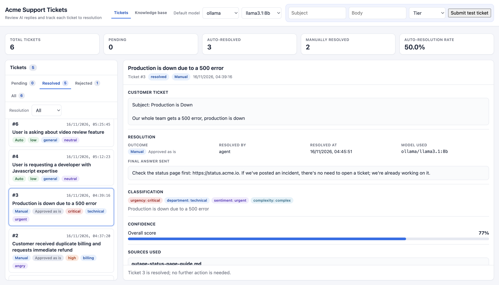
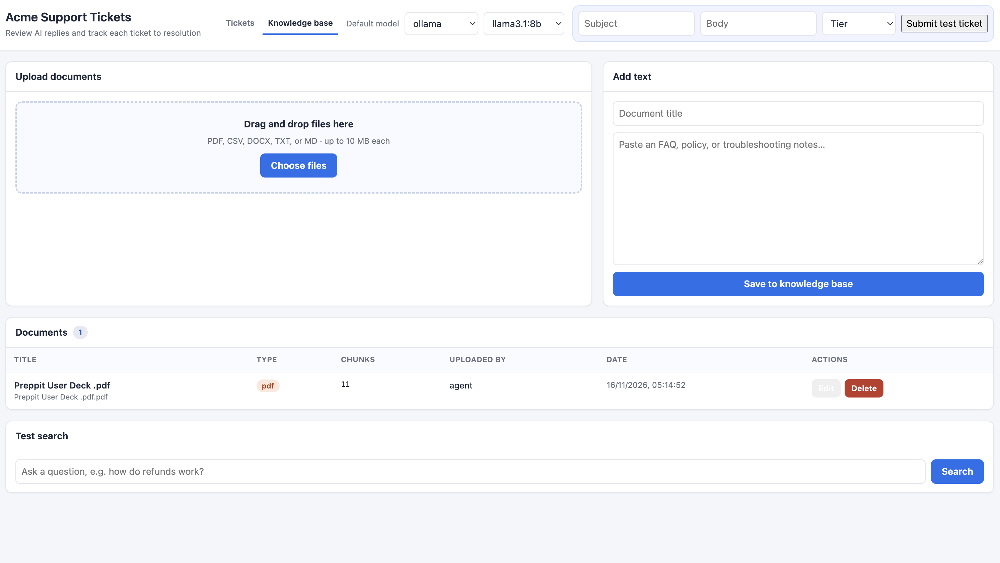

# ICSTRR — AI Support Ticket Review

ICSTRR is an end-to-end support automation demo: a FastAPI + LangGraph backend
triages every inbound ticket, retrieves matching knowledge-base passages from a
ChromaDB vector store, drafts a grounded reply, scores its own confidence, and
either answers the customer automatically or escalates the ticket to a human
with a handoff note. Every ticket — auto-resolved, manually approved, edited,
written by an agent, or rejected — is persisted with its classification,
confidence, sources and model so the team can measure the auto-resolution rate.
A React dashboard provides the review queue, ticket history, live statistics, a
model selector and a knowledge-base manager for PDF/CSV/DOCX/Markdown uploads
and typed text.

See [ARCHITECTURE.md](ARCHITECTURE.md) for the workflow diagram.

## Screenshots





## Quick start with Docker

Requirements: Docker Desktop, plus [Ollama](https://ollama.com) running on the
host with both models pulled:

```bash
ollama pull llama3.1:8b
ollama pull nomic-embed-text
```

1. Create the environment file:

   ```bash
   cp .env.example .env
   # edit .env if you want the OpenAI fallback (OPENAI_API_KEY) or integrations
   ```

   `.env.example` sets `OLLAMA_BASE_URL=http://host.docker.internal:11434`;
   `docker-compose.yml` maps `host.docker.internal` to the Docker gateway, so
   containers can reach Ollama on the host on macOS, Windows and Linux.

2. Build and start both services:

   ```bash
   docker compose up --build -d
   ```

3. Open the dashboard at <http://localhost:5173> and the API docs at
   <http://localhost:8000/docs>.


The `backend_data` volume starts empty and shadows the seed documents baked
into the image, so load the knowledge base once after the first start:

```bash
docker compose cp backend/data/kb/. backend:/app/data/kb/
docker compose exec backend python -c "import rag; rag.ingest()"
```

## Quick start without Docker

Backend (terminal 1):

```bash
cd backend
python3 -m venv .venv && source .venv/bin/activate
pip install -r requirements.txt
cp ../.env.example ../.env      # then set OLLAMA_BASE_URL=http://localhost:11434
python -c "import rag; rag.ingest()"   # build the Chroma index
uvicorn main:app --reload --port 8000
```

Frontend (terminal 2):

```bash
cd frontend
npm ci
npm run dev                     # http://127.0.0.1:5173
```

Vite proxies `/api/*` to `http://127.0.0.1:8000/*`, matching the nginx rewrite,
so no code change is needed between local and containerised runs.

## Environment variables

Copy `.env.example` to `.env`; only a reachable Ollama (or an OpenAI key) is
required.


The `*_PATH`, `KB_DIR` and `CHROMA_DIR` overrides are what `docker-compose.yml`
uses to push every mutable file into the `backend_data` / `chroma_db` volumes.


## Ticket flow and confidence scoring

Each ticket runs through the LangGraph state machine in `backend/graph.py`:

1. **classify** — the LLM returns a `Classification` (urgency, department,
   complexity, sentiment, required action, key entities) via structured output.
2. **retrieve** — the ticket text plus its key entities are used as the Chroma
   query; the top 4 chunks are formatted into a context block with source names
   and similarity scores.
3. **draft_resolution** — the LLM writes a reply grounded in that context and
   sets `can_resolve` when the knowledge base actually answers the question.
4. **score_confidence** — a second LLM call scores four dimensions, and the
   overall confidence is the weighted average
   `0.4 × grounded + 0.3 × complete + 0.1 × tone + 0.2 × risk`
   (grounding and completeness dominate; risk is scored so that higher means
   safer). The same call returns a list of `issues`.
5. **route** — the conditional edge auto-replies only when **all** of these hold:
   - `confidence >= CONFIDENCE_THRESHOLD`
   - the draft reports `can_resolve = true`
   - classification complexity is `simple`
   - urgency is not `critical`

   Otherwise the ticket is escalated.

**Outcomes**

| Path | What happens | `status` / `resolution_type` |
| --- | --- | --- |
| `auto_reply` | Reply sent to the customer (Zendesk or mock sender), recorded as resolved by `ai` | `resolved` / `auto` |
| `escalate` | Handoff note generated, item queued, Slack alert sent | `pending` / – |
| Agent approves the draft | Draft sent unchanged | `resolved` / `manual_approved` |
| Agent approves edited text | Edited reply sent and saved to the knowledge base | `resolved` / `manual_edited` |
| Agent writes the answer | Answer stored, nothing emailed | `resolved` / `manual_written` |
| Agent rejects | Ticket closed with no reply | `rejected` / – |

`GET /stats` counts these buckets and returns `auto_resolution_rate`
(`auto_resolved / total`). Every reviewer action on `/tickets/{id}/...` updates
the same row, so the dashboard history and the metrics stay in sync.

## Knowledge base upload formats

| Source | Handling |
| --- | --- |
| `.pdf` | `pypdf` per-page text, page number kept in metadata |
| `.csv` | Each row is kept as one chunk (question/answer pairs stay intact) when detected as Q&A |
| `.docx` | `python-docx` paragraph text |
| `.txt` / `.md` | Plain text, chunked by `RecursiveCharacterTextSplitter` (800 chars, 100 overlap) |
| Typed text | Added through `POST /kb/text` (or the KB page editor) with a title |

Limits and behaviour: 10 MB per file (`MAX_FILE_BYTES` in `loaders.py`, 25 MB per
request through nginx), duplicates rejected by SHA-256 hash, re-indexing replaces
the previous chunks, and deleting a document removes its vectors. Resolution
write-back (`rag.add_resolution`) also stores
`resolved-ticket-YYYYMMDD-HHMMSS.md` files under the KB directory.


The FastAPI app also owns the review surface: `GET /tickets`,
`POST /tickets/{id}/{approve,resolve,reject}`, `GET /stats`, the legacy
`/escalations` aliases, and the `/kb/*` management endpoints. The React bundle
is served by nginx, which proxies `/api/*` to the backend and strips the prefix;
the Vite dev server mirrors that proxy so the same relative URLs work locally.

## Tech stack

| Layer | Technology |
| --- | --- |
| API | Python 3.11, FastAPI, Uvicorn, Pydantic |
| Workflow | LangGraph (StateGraph), LangChain core |
| LLM providers | Ollama (`llama3.1:8b` by default), OpenAI fallback (`gpt-4o-mini`) |
| Retrieval | ChromaDB + Ollama embeddings (`nomic-embed-text`), `RecursiveCharacterTextSplitter` (800/100) |
| Persistence | SQLite (`tickets`, `escalations`, `kb`), JSON settings file, Chroma on disk |
| Document parsing | `pypdf`, `python-docx`, CSV reader, plain text/Markdown |
| Integrations | Zendesk REST, Slack SDK, IMAP email polling, `DRY_RUN` mode |
| Frontend | React 18, Vite 5, hand-written CSS |
| Delivery | Docker multi-stage builds, nginx, Docker Compose with named volumes |

## Repository layout

```
backend/
  main.py            FastAPI app: webhooks, tickets, escalations, KB, models, settings
  graph.py           LangGraph nodes, routing, confidence gate, ticket persistence
  prompts.py         Prompt templates + Pydantic schemas (Classification, Resolution, Score)
  llm.py             Provider/model registry with fallback chain
  rag.py             Chroma ingestion, retrieval, resolution write-back
  loaders.py         PDF/CSV/DOCX/text extraction (10 MB per file)
  kb_store.py        SQLite catalogue of KB documents (hash, chunks, uploader)
  ticket_store.py    SQLite ticket history and lifecycle
  settings.py        Per-user provider/model preference (settings.json)
  integrations.py    Zendesk, Slack and IMAP helpers
  data/kb/           Seed knowledge-base documents
frontend/
  src/App.jsx            Ticket dashboard (tabs, stats, model selector, test form)
  src/KnowledgeBase.jsx  KB management page
  src/api.js             `API_BASE` helper (`/api` by default)
  vite.config.js         Dev server + `/api` proxy
  nginx.conf             Static hosting + `/api` proxy for the container image
docker-compose.yml   backend + frontend services and named volumes
```


## Data and persistence

| Path in the container | Contents |
| --- | --- |
| `/app/data/tickets.sqlite3` | Ticket history, classification, sources, resolution type |
| `/app/data/escalations.sqlite3` | Escalation review records and legacy statuses |
| `/app/data/kb.sqlite3` | KB catalogue: hash, chunk count, uploader, typed content |
| `/app/data/settings.json` | Per-user provider/model preference |
| `/app/data/kb/` | Seed, uploaded and generated knowledge-base files |
| `/app/chroma_db/` | Chroma vector store |

`docker-compose.yml` keeps all of it in the `backend_data` and `chroma_db` named
volumes, so `docker compose down` preserves state (`down -v` resets it). Runtime
artefacts (SQLite files, `chroma_db/`, `.env`, `settings.json`, timestamped
resolved-ticket files) are git-ignored; the two seed `resolved-ticket-10xx` and
`-11xx` documents stay tracked.

## API reference

| Method | Path | Description |
| --- | --- | --- |
| GET | `/health` | Liveness probe |
| POST | `/webhook/zendesk` | Run the workflow for a Zendesk ticket payload |
| POST | `/webhook/email` | Run the workflow for an inbound email payload |
| POST | `/test-ticket` | Run the workflow for an ad-hoc ticket |
| GET | `/tickets?status=` | List tickets (`pending`, `resolved`, `rejected`, `all`) |
| GET | `/tickets/{id}` | Ticket detail incl. sources, draft and confidence |
| POST | `/tickets/{id}/approve` | Send the draft (optionally edited) and resolve |
| POST | `/tickets/{id}/resolve` | Record an agent-written answer |
| POST | `/tickets/{id}/reject` | Reject without replying |
| GET | `/stats` | Totals, pending, auto/manual resolutions, rate |
| GET | `/escalations`, `/escalations/{id}` | Legacy review-queue aliases |
| POST | `/escalations/{id}/approve` \| `reject` \| `resolve` | Legacy review actions |
| POST | `/kb/upload` | Upload one or more PDF/CSV/DOCX/TXT/MD files |
| POST | `/kb/text` | Add a typed document |
| GET | `/kb`, `/kb/{id}` | List or read KB documents |
| PUT | `/kb/{id}` | Replace content and re-index |
| DELETE | `/kb/{id}` | Delete a document and its chunks |
| POST | `/kb/search` | Similarity search over the vector store |
| GET | `/models` | Provider/model allowlist and defaults |
| GET/PUT | `/settings/{user_id}` | Read or update the default model |

## Known limitations

- **No OCR for scanned PDFs.** `pypdf` only extracts an existing text layer, so
  image-only PDFs index as empty documents (they are rejected with
  "No indexable text"). Add OCR (e.g. `ocrmypdf`/Tesseract) before upload.
- **No authentication yet.** The API and dashboard are unauthenticated, and
  `/settings/{user_id}` trusts the caller-supplied id. Run it on localhost or a
  trusted network only; put an auth proxy in front before exposing it.
- **Uploaded text is trusted.** Retrieved chunks and the ticket body are
  inserted into prompts verbatim, so a malicious document or ticket can attempt
  prompt injection ("ignore previous instructions…"). Review KB content, and
  prefer `DRY_RUN=true` while experimenting.
- **Single default model preference.** The dashboard persists the choice for the
  `default` user; there is no per-reviewer login or audit trail.
- **Mock senders.** With `DRY_RUN=true`, or without Zendesk/Slack credentials,
  outbound replies and alerts are logged instead of delivered.
- **Retrieval quality depends on the local embedding model**, so re-index after
  changing `EMBED_MODEL` or swapping providers.
